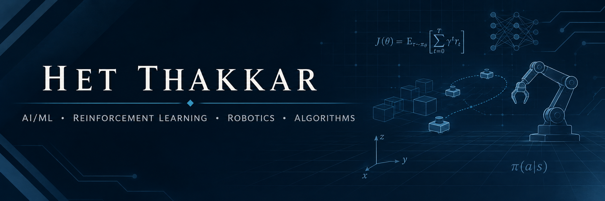

  

<h1 align="center">Het Thakkar</h1>

  <big><strong>CSE Undergraduate @ IIT Jodhpur · Class of 2029</strong></big> 
  Algorithms · Reinforcement Learning · AI/ML · Robotics

  
 
  
 
  

---

## About

I'm a second-year Computer Science and Engineering undergraduate at **IIT Jodhpur** with a **9.70/10 CGPA** through my first two semesters. I ranked **1st in Semester I and 2nd in Semester II**.

I enjoy working on problems that combine logical reasoning with implementation—from debugging reinforcement-learning experiments to building a physical robot that converts images into sketches. My current interests include **AI/ML, reinforcement learning, autonomous robotics, algorithms, AI for Science, and secure AI systems**.

My approach is to understand the system, test its assumptions, investigate failures, and improve the implementation—not just make it run.

## Featured Projects

<table>
  <tr>
    <td width="50%" valign="top">
      <h2><a href="https://github.com/thakkar-het/HiveMind-Multi_agent_reinforcement_learning">HiveMind</a></h2>
      
<strong>Multi-Agent Reinforcement Learning</strong>

      
A cooperative warehouse simulation with four robots, randomly sized shelves, multiple resources, collision avoidance, and a shared depot. The project investigates whether emergent communication improves coordination and task performance.

      
<strong>My contribution:</strong> CNN-based observation feature extraction, work across the environment/training/evaluation pipeline, and substantial debugging of unstable training using TensorBoard diagnostics.

      
<em>Python · PyTorch · CNN · Recurrent PPO · LSTM · Stable-Baselines3 · TensorBoard</em>

    </td>
    <td width="50%" valign="top">
      <h2><a href="https://github.com/thakkar-het/Painting_Arm">Bob Ross Without ROS</a></h2>
      
<strong>Computer Vision × Robotics</strong>

      
A working 3-DOF robotic arm that converts an input image into a sketch. The custom pipeline covers image processing, stroke extraction, coordinate mapping, inverse kinematics, trajectory generation, and motion refinement.

      
<strong>Hardware:</strong> Dynamixel motors, U2D2, Raspberry Pi, Arduino Nano, and pen-lift servo.

      
<em>Python · OpenCV · NumPy · Inverse Kinematics · Trajectory Planning · C++</em>

    </td>
  </tr>
  <tr>
    <td width="50%" valign="top">
      <h2><a href="https://github.com/thakkar-het/Othello_Reinforcement_learning">Othello RL Agent</a></h2>
      
<strong>Reinforcement Learning</strong>

      
An agent for the 8×8 Othello board game. After PPO did not produce satisfactory results, I switched to DQN and developed a stronger self-play-trained agent. The final interface supports playing against a human with either color.

      
<strong>Focus:</strong> Reward design, training diagnostics, and keeping reward and parameter scales suitable for learning.

      
<em>Python · DQN · Reinforcement Learning · Pygame</em>

    </td>
    <td width="50%" valign="top">
      <h2><a href="https://github.com/thakkar-het/Communication-Protocol">DNA Link</a></h2>
      
<strong>Fault-Tolerant Microcontroller Communication</strong>

      
A custom protocol inspired by DNA complementarity. Messages are encoded as bits with a conjugate representation; mismatches trigger retransmission and reconstruction of affected bits. Tested between Arduino boards by deliberately introducing wire-level errors.

      
<strong>Focus:</strong> Bit-level encoding, error detection, retransmission, and serial communication.

      
<em>Arduino · C++ · Bit-Level Encoding · Error Detection · Retransmission</em>

    </td>
  </tr>
</table>

## Research

### Secure Retrieval-Augmented Generation (RAG) — Sprit Lab, IIT Jodhpur
**Project team member · Ongoing research**

Working under **Prof. Susil Kumar Mohanty** on the design of a security-focused RAG pipeline. The current research phase explores a filtering stage intended to identify potentially malicious or poisoned retrieved documents before reranking and context generation, with reranking also being investigated as an extension.

Current work includes reading research papers, comparing design options, and developing a robust architecture. **Implementation and evaluation have not started yet.**

## Technical Skills

### Core strengths
- **C / C++:** OOP, STL, memory and file handling, debugging
- **Data Structures & Algorithms:** 250+ LeetCode problems solved; experience across easy, medium, and hard problems
- **Python:** Practical use of libraries and project code; less independent debugging experience than in C/C++
- **Machine Learning / Deep Learning:** Model training, interpreting results, and ML fundamentals
- **Computer Vision:** OpenCV-based image processing and an image-to-robot-motion pipeline
- **Reinforcement Learning:** Q-learning, PPO, recurrent PPO with LSTM, and DQN; training diagnostics with TensorBoard
- **Scientific Python:** NumPy, Pandas, Matplotlib, Seaborn
- **Robotics & embedded systems:** Arduino, Dynamixel, hardware/software integration, and serial communication
- **Tools:** Git, GitHub, Linux

## Current Interests

- Reinforcement learning and multi-agent systems
- AI/ML and deep learning
- Autonomous robotics
- Algorithms and mathematical problem solving
- AI for Science
- Security and reliability of LLM-based systems

## GitHub

  

---

  <big><em>Build it. Understand it. Find where it breaks. Improve it.</em></big>

